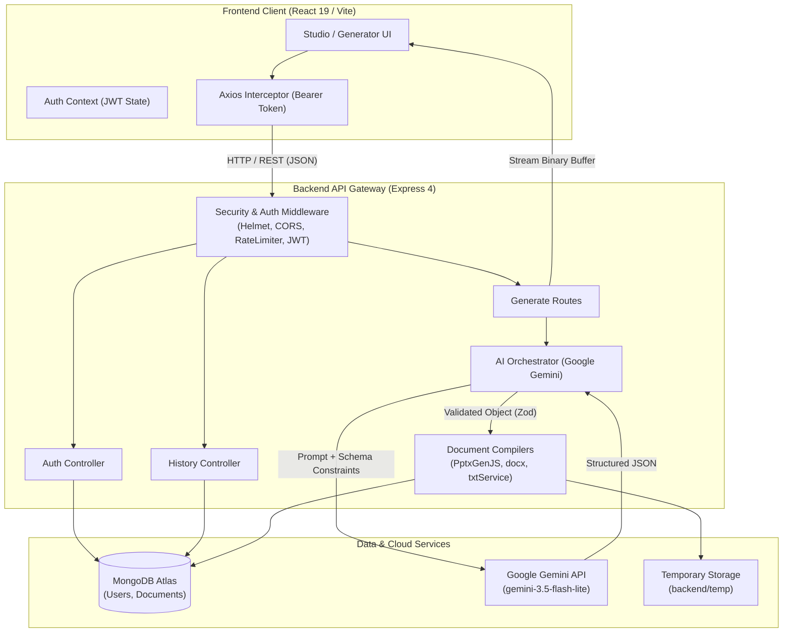

# DocuGenius AI

> An intelligent, full-stack document and presentation generation platform powered by Google Gemini, Node.js, Express, MongoDB, and React 19.

---

## 1. Project Overview

**DocuGenius AI** is an AI-powered document and presentation generation platform that transforms raw concepts, topics, and outlines into publication-ready presentations, structured business reports, and plain-text specifications using Google Gemini.

Traditional document and presentation authoring is frequently manual, repetitive, and fragmented across disjointed software. DocuGenius AI streamlines this workflow through an automated pipeline:

- **Presentations (`.pptx`)**: Generates styled PowerPoint slide decks with curated color palettes, typography, intelligent content splitting across slides, speaker notes, and diagram representations.
- **Documents (`.docx`)**: Compiles formal Word documents featuring title headers, section hierarchies, tables, and formatted bullet lists.
- **Plain Text (`.txt`)**: Produces structured plain-text specifications formatted with double-underline title banners, section headers, and clean bullet lists.

DocuGenius AI pairs an intuitive React 19 single-page application with a secure, rate-limited, and audited Express backend API.

---

## 2. Technology Stack

All documented technologies and dependencies are verified against project source code and `package.json` manifests:

### Frontend
| Package | Version | Purpose |
|---|---|---|
| **React** | `^19.2.0` | Declarative UI component architecture |
| **React DOM** | `^19.2.0` | DOM rendering engine for React 19 |
| **Vite** | `^7.2.4` | Development tooling and production bundling |
| **Tailwind CSS** | `^4.3.5` | Utility-first CSS styling framework |
| **@tailwindcss/vite** | `^4.3.5` | Vite plugin integration for Tailwind CSS v4 |
| **React Router DOM** | `^7.18.5` | Client-side routing and protected route guards |
| **Axios** | `^1.13.2` | Promise-based HTTP client with request interceptors |
| **Lucide React** | `^1.73.0` | Icon system for modern interface components |

### Backend & Database
| Package | Version | Purpose |
|---|---|---|
| **Node.js** | `>=20.0.0` | JavaScript runtime environment (ECMAScript Modules) |
| **Express.js** | `^4.18.2` | RESTful web framework and middleware pipeline |
| **MongoDB / Mongoose** | `^8.8.0` | Document database and ODM with schema validation |
| **@google/generative-ai** | `^0.24.1` | Official Google Gemini API client library |
| **PptxGenJS** | `^3.12.0` | Programmatic PowerPoint (`.pptx`) compilation engine |
| **docx** | `^9.15.4` | Programmatic Word (`.docx`) document generation library |
| **pureimage** | `^0.4.18` | Pure JavaScript 2D graphics implementation for diagrams |
| **svg-text** | `^0.5.1` | SVG text measurement and layout helper |
| **Zod** | `^4.6.7` | Runtime schema validation for requests and AI output |
| **bcryptjs** | `^2.4.3` | Password hashing using salt work factor 12 |
| **jsonwebtoken** | `^9.0.2` | JWT authentication and session token issuance |
| **cookie-parser** | `^1.4.6` | Signed and unsigned HTTP cookie parsing middleware |
| **helmet** | `^8.0.0` | Security headers middleware for HTTP response protection |
| **cors** | `^2.8.5` | Cross-Origin Resource Sharing configuration |
| **express-rate-limit** | `^7.4.1` | IP-based request rate limiting and abuse prevention |
| **express-validator** | `^7.2.0` | Express request validation utility |
| **winston** | `^3.18.3` | Application logging framework |
| **winston-daily-rotate-file** | `^5.0.0` | Daily log rotation with archiving and retention |
| **uuid** | `^10.0.0` | Unique identifier generation for files and sessions |
| **dotenv** | `^16.4.5` | Environment variable loader from configuration files |
| **@opentelemetry/sdk-node** | `^0.217.0` | Application telemetry and distributed tracing SDK |
| **@opentelemetry/auto-instrumentations-node** | `^0.75.0` | Automated telemetry instrumentation for Node.js |
| **@opentelemetry/exporter-trace-otlp-http** | `^0.217.0` | OTLP HTTP trace exporter |

---

## 3. Architecture & Data Flow

DocuGenius AI organizes concerns across user interface, API gateway, AI orchestration, and file generation layers:



### Key Architectural Behaviors
1. **Schema-Constrained AI Generation**: Gemini is prompted to return strictly valid JSON. Responses are validated against explicit Zod schemas (`aiPptxSchema`, `aiDocxSchema`, or `aiTxtSchema`) before file compilation proceeds.
2. **On-Demand Recompilation Fallback**: In the primary download endpoint (`GET /api/generate/:id/download`), if a temporary file in `backend/temp/` is purged or lost after a server restart, the route automatically re-compiles the binary buffer directly from the structured content and settings stored in MongoDB without re-calling Gemini.
3. **Dual Authentication Transport**: Supports both HTTP-only cookies and `Authorization: Bearer <token>` headers, enabling flexible client authorization across deployment models.

---

## 4. Key Features

### Document & Presentation Generation
- **PowerPoint Generation (`.pptx`)**: Generates structured presentations with title slides, section headers, bullet lists, speaker notes, and diagram visuals.
- **7 Curated Presentation Themes**:
  - `corporate`: Navy (`#003366`) and slate palette with clean Calibri typography.
  - `minimal`: High-contrast monochrome layout (`#111111`) with generous whitespace.
  - `academic`: Forest green (`#1b4d3e`) and deep slate palette with Georgia serif headings.
  - `businessPitch`: Dark-mode backdrop (`#1a1a2e`) with amber and orange accents.
  - `technology`: Deep charcoal backdrop (`#121212`) with neon purple and violet accents.
  - `educational`: Teal (`#008080`) and emerald palette with accessible styling.
  - `creative`: Magenta, purple, and coral accents for high-energy concepts.
- **Slide Overflow Splitting**: Slides with more than 6 bullet points are split into logically sequenced continuation slides with matching themes.
- **Word Document Generation (`.docx`)**: Compiles formal reports with title page metadata, heading hierarchies (Levels 1–3), bullet lists, tables with header rows, and page numbers.
- **Plain Text Specifications (`.txt`)**: Compiles plain text documents formatted with double-underline title banners, section headers, and clean bullet lists.
- **Diagram Service**: Parses Mermaid diagram syntax (`graph TD`, `graph LR`, `sequenceDiagram`) and generates visual diagrams or formatted text representations.
- **Instant Outline Preview**: `POST /api/generate/preview` returns structured outline data without writing files to disk.

### Account & Security Features
- **User Authentication**: User registration and login with bcrypt password hashing (salt work factor 12).
- **JWT Protection**: Protected routes require valid JSON Web Tokens passed via HTTP-only cookie or Bearer authorization header.
- **Document History & Isolation**: User-isolated document repository with search, format filters (`pptx`, `docx`, `txt`), document deletion, and summary metrics.
- **Strict Production CORS**: Cross-origin requests restricted to explicitly configured frontend URLs in production.
- **Hardened Logging**: Request logging captures method, route, status, response time, and user ID (`userId`), while excluding user email addresses and redacting sensitive query parameters. Daily rotation with 20MB caps and 30-day retention.

---

## 5. Project Structure

```text
mern-text-to-ppt/
├── .gitignore                      # Git exclusion rules for root
├── README.md                       # Project documentation
├── backend/                        # Express API server
│   ├── .env.example                # Backend environment variable template
│   ├── .gitignore                  # Backend Git exclusion rules
│   ├── package.json                # Backend dependencies and scripts
│   ├── server.js                   # Application entry point, middleware & route mounting
│   ├── analyzer/                   # Request log analysis and metric aggregation
│   │   ├── export.js               # CSV and JSON summary exporters
│   │   ├── functional.js           # Endpoint flow tracking
│   │   ├── index.js                # Analyzer entry point
│   │   ├── parser.js               # Safe log file reader (skips non-log files)
│   │   └── performance.js          # Latency analysis
│   ├── config/
│   │   └── db.js                   # MongoDB connection management
│   ├── controllers/
│   │   ├── authController.js       # Register, login, logout, and getMe handlers
│   │   └── historyController.js    # Document history listing, stats, deletion, and download
│   ├── middleware/
│   │   ├── auth.js                 # JWT verification (cookie and Bearer header)
│   │   ├── errorHandler.js         # Centralized error handler with secret redaction
│   │   ├── logger.js               # Winston daily-rotate transport configuration
│   │   ├── logMiddleware.js        # Request logger (URL sanitization, userId tracking)
│   │   ├── rateLimiter.js          # Auth (10/15min) and API (30/1min) rate limiters
│   │   ├── validate.js             # Express-validator middleware
│   │   └── zodValidate.js          # Zod schema validation middleware for request bodies
│   ├── models/
│   │   ├── Document.js             # Document metadata, structured content, and settings schema
│   │   └── User.js                 # User schema and bcrypt password comparison
│   ├── routes/
│   │   ├── auth.js                 # Authentication routes (/api/auth)
│   │   ├── generate.js             # Document generation, preview, & downloads (/api/generate)
│   │   ├── history.js              # History listing, stats, and deletion (/api/history)
│   │   ├── logAnalyzer.js          # Log analysis metrics endpoint (/api/log-analyzer)
│   │   └── ppt.js                  # Legacy direct PPT generation endpoint (/api/ppt)
│   ├── services/
│   │   ├── aiService.js            # Google Gemini prompt builder, retry logic, & Zod parsing
│   │   ├── diagramService.js       # Mermaid diagram parsing & SVG/text generation
│   │   ├── docxService.js          # Word document builder
│   │   ├── pptService.js           # PowerPoint presentation builder
│   │   └── txtService.js           # Plain text specification builder
│   ├── tests/
│   │   ├── live_integration_test.mjs    # End-to-end tests with live Atlas & Gemini
│   │   ├── logging_security_test.mjs    # Log rotation and secret redaction tests
│   │   ├── phase2_test.mjs              # Model, auth, and Zod unit tests
│   │   ├── phase3_test.mjs              # Generation engine and diagram tests
│   │   ├── phase4_integration_test.mjs  # API contract and build verification tests
│   │   └── production_readiness_test.mjs# Recompilation, health check, and CORS tests
│   └── utils/
│       ├── fileCleanup.js          # Scheduled hourly cleanup for temp files older than 24h
│       └── responseHelper.js       # Uniform JSON response utilities (success/error)
└── frontend/                       # React 19 / Vite client application
    ├── .env.example                # Frontend environment variable template
    ├── .gitignore                  # Frontend Git exclusion rules
    ├── index.html                  # HTML template entry point
    ├── package.json                # Frontend dependencies and scripts
    ├── vercel.json                 # Vercel SPA routing rewrite rules
    ├── vite.config.js              # Vite configuration with Tailwind CSS plugin
    └── src/
        ├── App.jsx                 # Application shell and route configurations
        ├── main.jsx                # DOM root entry point
        ├── api/
        │   └── axios.js            # Axios client with base URL resolution & token interceptors
        ├── components/
        │   ├── auth/
        │   │   └── ProtectedRoute.jsx # Route guard redirecting unauthenticated users
        │   └── layout/
        │       ├── Footer.jsx      # Global application footer
        │       └── Navbar.jsx      # Header navigation bar with user session controls
        ├── context/
        │   └── AuthContext.jsx     # Authentication context provider with demo preview mode
        └── pages/
            ├── Dashboard.jsx       # User dashboard with quick generation actions
            ├── Generator.jsx       # Interactive document generator studio and preview
            ├── History.jsx         # Document history table, filters, and downloads
            ├── Landing.jsx         # Marketing landing page
            ├── Login.jsx           # User authentication login page
            ├── Profile.jsx         # User account details page
            ├── Register.jsx        # Account registration page
            └── Settings.jsx        # Preferences and model status display
```

---

## 6. Installation & Local Setup

### Prerequisites
- **Node.js**: Version `20.x` or higher (LTS recommended)
- **npm**: Version `9.x` or higher
- **MongoDB**: Local MongoDB instance or free MongoDB Atlas cluster
- **Google Gemini API Key**: Acquired from [Google AI Studio](https://aistudio.google.com/)

### Step 1: Clone the Repository
```bash
git clone https://github.com/Utkarsh127/DocuGenius-AI.git
cd DocuGenius-AI
```

### Step 2: Configure Backend
```bash
cd backend
npm install
cp .env.example .env
```

Configure `backend/.env` with your settings:
```env
PORT=5000
NODE_ENV=development
MONGODB_URI=mongodb+srv://<username>:<password>@cluster.mongodb.net/docugenius?retryWrites=true&w=majority
JWT_SECRET=your_super_secret_jwt_key_at_least_32_characters
JWT_EXPIRES_IN=7d
COOKIE_SECRET=your_cookie_signing_secret_here
GEMINI_API_KEY=your_actual_google_gemini_api_key_here
GEMINI_MODEL=gemini-3.5-flash-lite
FRONTEND_URL=http://localhost:5173
```

### Step 3: Configure Frontend
Open a separate terminal:
```bash
cd frontend
npm install
cp .env.example .env
```

Configure `frontend/.env`:
```env
VITE_API_URL=http://localhost:5000/api
```

### Step 4: Run the Application
In your backend terminal:
```bash
npm run dev
```

In your frontend terminal:
```bash
npm run dev
```

Access the application at `http://localhost:5173`.

---

## 7. Environment Variables Reference

Never commit `.env` files to version control. Both root `.gitignore` and `backend/.gitignore` exclude `.env` files.

### Backend (`backend/.env`)
| Variable | Description | Required | Default Value | Example |
|---|---|:---:|---|---|
| `PORT` | Port the Express server listens on | No | `5000` | `5000` |
| `HOST` | Interface IP binding | No | `0.0.0.0` | `0.0.0.0` |
| `NODE_ENV` | Application environment mode | No | `development` | `development` / `production` |
| `MONGODB_URI` | MongoDB connection string | Yes | — | `mongodb+srv://...` |
| `JWT_SECRET` | Secret key used to sign and verify JWT tokens | Yes | — | `random_64_character_string` |
| `JWT_EXPIRES_IN` | Duration before a JWT token expires | No | `7d` | `7d` |
| `COOKIE_SECRET` | Secret key used by `cookie-parser` for signed cookies | No | — | `random_32_character_string` |
| `GEMINI_API_KEY` | Google Gemini API key | Yes | — | `AIzaSy...` |
| `GEMINI_MODEL` | Gemini generative model name (live-verified default) | No | `gemini-3.5-flash-lite` | `gemini-3.5-flash-lite` |
| `FRONTEND_URL` | Allowed origin for CORS in production | Yes (in prod) | — | `https://docugenius-ai.vercel.app` |
| `LOG_LEVEL` | Minimum log level threshold for Winston logger | No | `info` | `info` / `warn` / `error` |

### Frontend (`frontend/.env`)
| Variable | Description | Required | Default Value | Example |
|---|---|:---:|---|---|
| `VITE_API_URL` | Base URL of the backend API | Yes | `'/api'` (in production fallback) | `http://localhost:5000/api` |

---

## 8. API Documentation

All endpoints, methods, middleware protections, and payloads are verified against backend route definitions:

### System Health
| Method | Endpoint | Access | Middleware | Description |
|---|---|:---:|---|---|
| `GET` | `/health` | Public | None | System uptime and health status (`{ status: 'ok', uptime, timestamp }`) |
| `GET` | `/api/health` | Public | None | Namespaced API health status check |

### Authentication (`/api/auth`)
| Method | Endpoint | Access | Middleware | Description / Payload |
|---|---|:---:|---|---|
| `POST` | `/api/auth/register` | Public | `authLimiter`, `validateBody(registerSchema)` | Registers a new user account.<br/>**Body**: `{ name, email, password }`<br/>**Response** (201): Sets HTTP-only `token` cookie and returns user object with token. |
| `POST` | `/api/auth/login` | Public | `authLimiter`, `validateBody(loginSchema)` | Authenticates user credentials.<br/>**Body**: `{ email, password }`<br/>**Response** (200): Sets HTTP-only `token` cookie and returns user object with token. |
| `POST` | `/api/auth/logout` | Public | None | Clears the HTTP-only `token` cookie. *(Note: Tokens are stateless JWTs; client-side storage must also discard the token).* |
| `GET` | `/api/auth/me` | Protected | `auth` | Fetches the authenticated user profile based on validated token (`{ id, name, email, role, createdAt }`). |

### Document Generation (`/api/generate`)
| Method | Endpoint | Access | Middleware | Description / Payload |
|---|---|:---:|---|---|
| `POST` | `/api/generate` | Protected | `protect`, `apiLimiter` | Generates a full document (`pptx`, `docx`, `txt`) via Gemini, compiles the file to disk, and records metadata in MongoDB.<br/>**Body**: `{ title, type, topic?, description?, theme?, language?, tone?, audience?, contentLength?, slideCount? }`<br/>**Response** (201): Document record with `downloadUrl`. |
| `POST` | `/api/generate/preview` | Protected | `protect` | Generates structured outline content without creating a disk file.<br/>**Body**: `{ type, topic?, title?, description?, language?, tone?, audience?, contentLength? }`<br/>**Response** (200): Structured JSON content matching document type schema. |
| `POST` | `/api/generate/:id/regenerate` | Protected | `protect` | Re-runs generation with Gemini using the document's saved settings and updates the document record.<br/>**Params**: `id` (Document ID; verifies user ownership). |
| `GET` | `/api/generate/:id/download` | Protected | `protect` | **Primary download endpoint with fallback recompilation**.<br/>Downloads the generated file by document ID (verifies user ownership).<br/>**Fallback**: If the temporary file in `backend/temp/` is missing (due to server restart or 24-hour cleanup), it transparently recompiles the binary file from stored MongoDB content without calling Gemini again, caches the file, and streams it. |

### Document History (`/api/history`)
| Method | Endpoint | Access | Middleware | Description / Query Parameters |
|---|---|:---:|---|---|
| `GET` | `/api/history` | Protected | `auth` | Retrieves paginated document history for the authenticated user.<br/>**Query**: `?page=1&limit=10&type=pptx|docx|txt&search=...` |
| `GET` | `/api/history/stats` | Protected | `auth` | Returns total document count and format breakdown for the user (`{ total, byType: { pptx, docx, txt } }`). |
| `GET` | `/api/history/:id` | Protected | `auth` | Retrieves a single document by ID (verifies user ownership). |
| `DELETE` | `/api/history/:id` | Protected | `auth` | Deletes a document record from MongoDB and unlinks the cached file from disk (verifies user ownership). |
| `GET` | `/api/history/:id/download` | Protected | `auth` | **Static file stream endpoint (no recompilation fallback)**.<br/>Streams the cached file from `backend/temp/` (verifies user ownership). If the file was purged from disk, it returns `404 { success: false, error: 'File no longer exists on the server.' }`. |

### Legacy Direct Generation (`/api/ppt`)
| Method | Endpoint | Access | Middleware | Description / Payload |
|---|---|:---:|---|---|
| `POST` | `/api/ppt/generate` | Public | None | Direct text-to-presentation binary stream without user authentication, database persistence, or rate limiting.<br/>**Body**: `{ text, title }`<br/>**Response**: Streams `.pptx` download and unlinks temp file immediately upon completion.<br/>*Security Note: Because this legacy endpoint has no authentication or rate limiting, rate limiting must be applied via a reverse proxy in production.* |

### Log Analysis (`/api/log-analyzer`)
| Method | Endpoint | Access | Middleware | Description |
|---|---|:---:|---|---|
| `GET` | `/api/log-analyzer` | Public | None | Evaluates application log files in `backend/logs/` and returns aggregated endpoint and performance metrics.<br/>*Security Note: Because this endpoint has no authentication, it exposes operational metrics and log aggregations. It should be restricted or protected in production environments.* |

---

## 9. Testing & Verification

DocuGenius AI maintains an automated backend test suite covering unit schemas, file generation engines, integration contracts, live cloud services, and security hardening.

```bash
cd backend
```

```bash
# 1. Unit & Schema Tests (Phase 2: Models, bcrypt, Zod validation, JWT)
node tests/phase2_test.mjs
```

```bash
# 2. Document Engine Tests (Phase 3: PPTX themes, overflow logic, DOCX, TXT, diagrams)
node tests/phase3_test.mjs
```

```bash
# 3. API Contract & Build Checks (Phase 4: Route fallbacks, build checks)
node tests/phase4_integration_test.mjs
```

```bash
# 4. Live Cloud Integration Tests (Atlas DB persistence, real Gemini generation, history isolation)
node tests/live_integration_test.mjs
```

```bash
# 5. Logging & Security Tests (Rotation, file limits, secret redaction)
node tests/logging_security_test.mjs
```

```bash
# 6. Production Readiness Tests (Health checks, CORS origin enforcement, on-demand recompilation)
node tests/production_readiness_test.mjs
```

### Frontend Build Verification
```bash
cd frontend
npm run build
```

### Verified Test Summary
- **Automated Backend Tests**: **47/47 passing tests** across 6 test suites:
  - `phase2_test.mjs`: 12/12 passed
  - `phase3_test.mjs`: 8/8 passed
  - `phase4_integration_test.mjs`: 6/6 passed
  - `live_integration_test.mjs`: 8/8 passed
  - `logging_security_test.mjs`: 5/5 passed
  - `production_readiness_test.mjs`: 8/8 passed
- **Frontend Verification**: Production build succeeds cleanly via Vite (`npm run build`).
- **Manual Verification**: Interactive UI workflows (registration, document creation, and studio previews) have been manually verified in local browser testing.

---

## 10. Deployment Guide

DocuGenius AI is configured for deployment using **Vercel** for the frontend, **Render** for the backend, and **MongoDB Atlas** for data persistence.

### Step 1: Deploy Backend to Render
1. Create a new **Web Service** on Render connected to your GitHub repository.
2. Set configuration:
   - **Root Directory**: `backend`
   - **Environment**: `Node`
   - **Build Command**: `npm install`
   - **Start Command**: `node server.js`
3. Add Environment Variables:
   - `PORT`: Automatically set by Render
   - `NODE_ENV`: `production`
   - `MONGODB_URI`: `<your-production-mongodb-connection-string>`
   - `JWT_SECRET`: `<secure-random-32+-character-string>`
   - `COOKIE_SECRET`: `<secure-random-string>`
   - `GEMINI_API_KEY`: `<your-google-gemini-api-key>`
   - `GEMINI_MODEL`: `gemini-3.5-flash-lite`
   - `FRONTEND_URL`: `https://<your-vercel-app>.vercel.app`
4. Deploy the service and note the assigned URL (`https://<service-name>.onrender.com`).

### Step 2: Deploy Frontend to Vercel
1. Import the repository into Vercel.
2. Set configuration:
   - **Root Directory**: `frontend`
   - **Framework Preset**: `Vite`
   - **Build Command**: `npm run build`
   - **Output Directory**: `dist`
3. Add Environment Variable:
   - `VITE_API_URL`: `https://<your-render-service>.onrender.com/api`
4. Deploy. Vercel applies the client-side SPA routing rewrites configured in `frontend/vercel.json`.

### Free-Tier Operational Considerations
- **Render Inactivity Cold Starts**: Free-tier web services on Render spin down after 15 minutes of idle time. The initial wake-up request may experience a 30–50 second delay.
- **Ephemeral Storage Resilience**: Cloud container filesystems are ephemeral. If an instance restarts or local temporary files in `backend/temp/` are cleared, the application's **on-demand recompilation fallback** in `GET /api/generate/:id/download` transparently rebuilds PPTX, DOCX, and TXT files directly from structured MongoDB data.

---

## 11. Security & Operational Considerations

- **Password Security**: Passwords are saved as bcrypt hashes using salt work factor 12. Plaintext passwords are never stored.
- **Stateless JWT Sessions**: Session tokens are issued via JSON Web Tokens with configurable expiration (default 7 days). Dual-mode transport allows transmission via HTTP-only cookie or Authorization header. Logout invalidates the HTTP-only session cookie; clients are responsible for discarding any client-stored tokens.
- **Per-User Data Isolation**: Document retrieval, regeneration, deletion, and download routes query resources by `{ _id, userId }`, enforcing data isolation between authenticated accounts.
- **PII Scrubbing in Request Logs**: Request logs record system `userId` strings instead of user email addresses.
- **Secret Redaction**: Centralized error handlers and request loggers sanitize URLs and error messages, redacting query parameters and substrings matching passwords, tokens, API keys, and database connection strings.
- **Rate Limiting**:
  - Authentication routes (`/api/auth/register`, `/api/auth/login`) are limited to 10 requests per 15 minutes per IP.
  - Document generation (`/api/generate`) is limited to 30 requests per minute per IP.
- **HTTP Security Headers**: `helmet()` applies standard security headers including X-Content-Type-Options, Strict-Transport-Security, and frameguard protections.
- **Production CORS Enforcement**: In production mode (`NODE_ENV=production`), Cross-Origin requests from unlisted origins are strictly rejected.
- **Public API Considerations**:
  - `POST /api/ppt/generate` is an unauthenticated legacy endpoint that compiles presentations on demand. Rate limiting should be applied at the reverse-proxy layer in production to mitigate potential CPU exhaustion.
  - `GET /api/log-analyzer` is unauthenticated and exposes internal operational telemetry and log metrics. Access should be restricted to internal networks or authenticated administrators in production.

---

## 12. Current Limitations & Roadmap

### Current Limitations
- Generated files cached in `backend/temp/` rely on server disk space and are subject to hourly cleanup (files older than 24 hours) or container restarts. Permanent persistence relies on structured JSON stored in MongoDB with on-demand recompilation via `GET /api/generate/:id/download`.
- Presentations support 7 pre-configured color and typographic themes with automatic bullet overflow management, but do not yet support custom font uploads or arbitrary theme builders.

### Roadmap
- [ ] Direct integration with cloud object storage (Amazon S3 / Cloudflare R2) for permanent binary artifact retention.
- [ ] Presentation export directly to PDF and Google Slides format.
- [ ] Interactive in-browser slide editor allowing slide reordering and custom formatting prior to download.
- [ ] Team collaboration workspaces and document sharing permissions.

---

## 13. Contributing

1. Fork the repository.
2. Create a dedicated feature branch:
```bash
git checkout -b feature/your-feature-name
```
3. Commit your changes with descriptive messages:
```bash
git commit -m "feat: add feature description"
```
4. Verify that all automated tests pass:
```bash
cd backend && node tests/live_integration_test.mjs
cd ../frontend && npm run build
```
5. Push the feature branch to your fork and submit a Pull Request.

---

## 14. License

This repository does not currently contain an open-source license file. All rights are reserved by the project owner unless explicitly stated otherwise.
